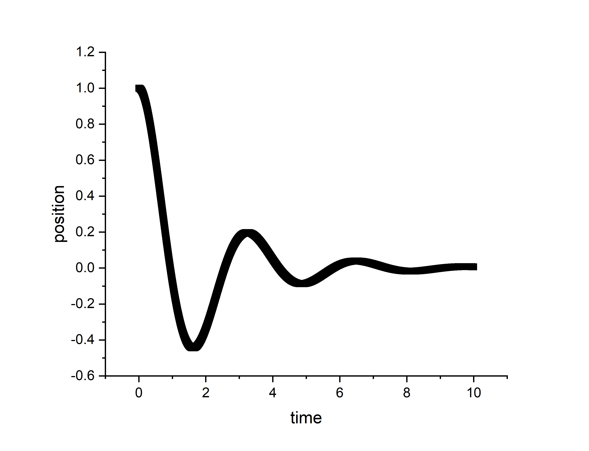
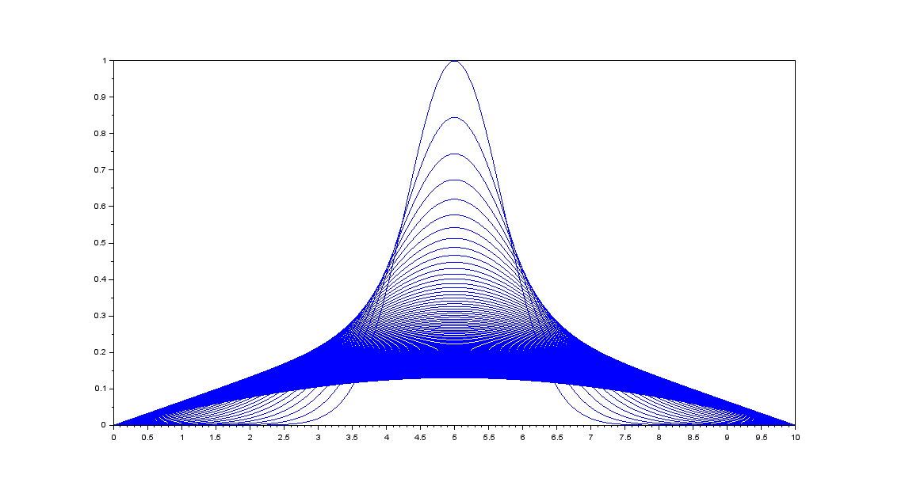
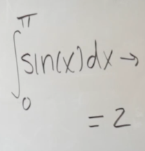

# Numerical methods

**Coursework implementations in Fortran and Scilab**

[](LICENSE)
[](https://fortran-lang.org/)
[](https://www.scilab.org/)

This repository collects numerical solutions to problems in ordinary
differential equations, partial differential equations, and integration. The
code was written for coursework and is kept as a reference for the methods.

**Author:** Zain Ul Abideen
**GitHub repository:** [dominuszain/NumericalMethods](https://github.com/dominuszain/NumericalMethods)

## Contents

| Folder | Problem | Method | Language |
|---|---|---|---|
| [`ode/`](ode/) | Damped harmonic oscillator | Euler's method | Fortran |
| [`finite-difference/`](finite-difference/) | 1D heat equation | Explicit finite differences | Scilab |
| [`monte-carlo/`](monte-carlo/) | 1D and 3D integrals | Monte Carlo sampling | Scilab |
| [`utils/`](utils/) | Small matrix and array helpers | Direct implementation | Fortran |

| Damped oscillator | Heat equation | Monte Carlo |
|---|---|---|
|  |  |  |

## Running the code

Fortran programs are compiled with `gfortran`:

```bash
cd ode
gfortran main.f90 -o oscillator
./oscillator
```

The oscillator program writes `out.txt` with time and displacement. Scilab
scripts are opened and run in Scilab; each folder contains the corresponding
report as `main.pdf`.

## Notes

- The explicit heat-equation scheme is stable only when
  `a² Δt / Δx² ≤ 1/2`.
- The Monte Carlo estimates converge as `1/√N`, so the results are
  probabilistic. Increase `n` for a smaller spread.
- The Fortran utilities in `utils/` show how to pass arrays between
  subroutines and how to read and write matrices.

## License

Released under the [MIT License](LICENSE).
